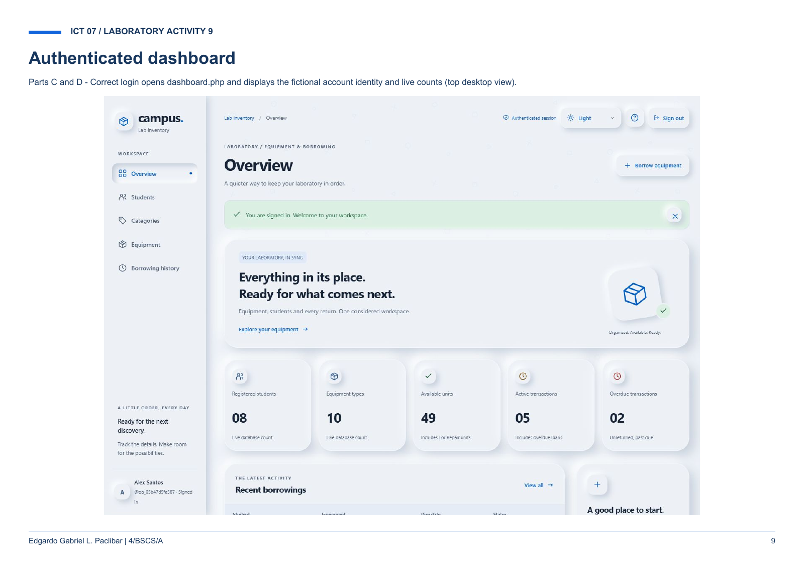

<div align="center">

# campus. · Laboratory Inventory

### PHP Web Security & Secure User Authentication

**ICT 07 · Laboratory Activity 9**

Edgardo Gabriel L. Paclibar · 4/BSCS/A

[Read the submission](Paclibar_Laboratory_Activity_9_Landscape.pdf) · [Dashboard preview](docs/images/dashboard.png)

</div>



## About this project

An academic submission documenting secure authentication for **campus.**, a laboratory inventory application with workspaces for students, categories, equipment, and borrowing history.

The supplied report follows the account journey from registration and validation through sign-in, the protected dashboard, and sign-out. It also documents password storage, rejected malicious input, and security observations.

**Repository contents:** the original 17-page PDF extracted from the submitted ZIP, a preview rendered from that PDF, and this project guide. The ZIP does not contain the application's PHP source, assets, SQL setup scripts, or executable tests, so this repository currently serves as submission documentation.

## Explore the report

| Pages | Content |
| :--- | :--- |
| 1 | Activity overview, author, and learning outcomes |
| 2–4 | Registration, password confirmation, and login form |
| 5–6 | Password hash storage and authentication table structure |
| 7–8 | Incorrect password and unknown username rejection |
| 9 | Authenticated inventory dashboard |
| 10–12 | Sign-out confirmation, logout, and protected-page redirect |
| 13–14 | HTML input and SQL-injection-style login rejection |
| 15 | Recorded security checks and observations |
| 16 | Four completed guided questions |
| 17 | Implementation mapping and original local setup notes |

## Security topics documented

- Password hashing with PHP `password_hash()` and verification with `password_verify()`.
- Prepared statements, input validation, and escaped output.
- Session ID rotation, protected pages, expiry, and logout.
- CSRF checks and login attempt limits.
- Rejection of invalid credentials, HTML input, and injection-style input.

The report records **45 checks passed and 0 failed on 4 November 2026**. Those are historical results reported in the PDF; the test runner and result JSON are not included in the supplied archive and have not been rerun for this repository. The report describes local academic checks, not a penetration-test certification.

## View the submission

Open **[the PDF report](Paclibar_Laboratory_Activity_9_Landscape.pdf)** in GitHub or download it to read locally. No installation is required to view the documentation.

The report references a PHP/MySQL application named `Laboratory9-SecureAuth`. Running that application requires its separate source folder and SQL scripts. The setup instructions on page 17 apply to that original project; this repository currently does not include those files or a live website deployment.

## Repository layout

```text
Gab_Webdesign_subject/
├── README.md
├── Paclibar_Laboratory_Activity_9_Landscape.pdf
└── docs/
    └── images/
        └── dashboard.png
```

## Submission details

| Field | Details |
| :--- | :--- |
| Author | Edgardo Gabriel L. Paclibar |
| Class | 4/BSCS/A |
| Subject | ICT 07 |
| Activity | Laboratory Activity 9 — PHP Web Security and Secure User Authentication |
| Evidence date | 4 November 2026 |
| Original archive | `Paclibar_Laboratory_Activity_9_Submission.zip` |

The PDF states that fictional accounts were used for its evidence. The dashboard image above is a saved report capture, not a live connection to an application or database.
